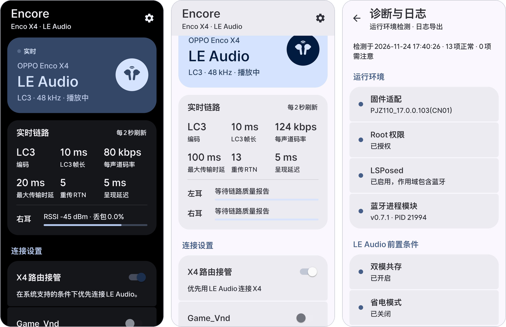
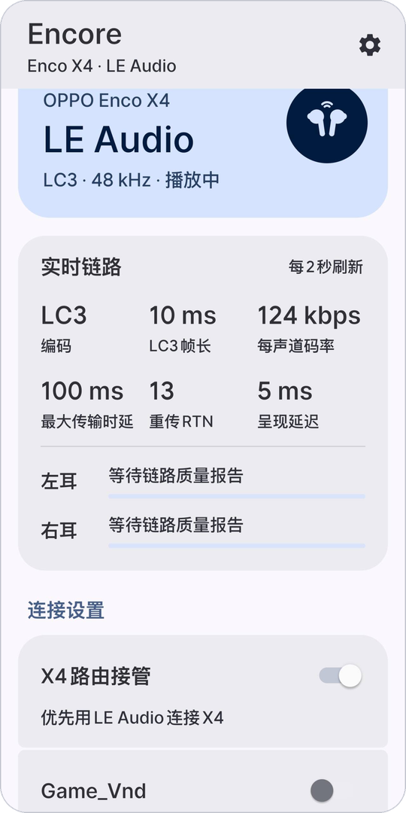
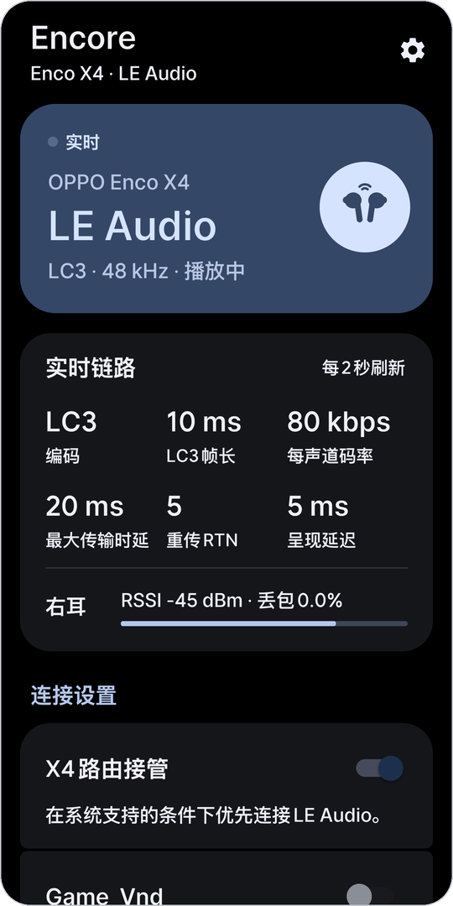
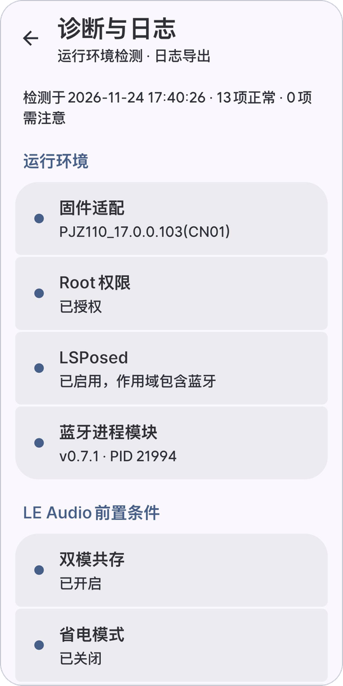
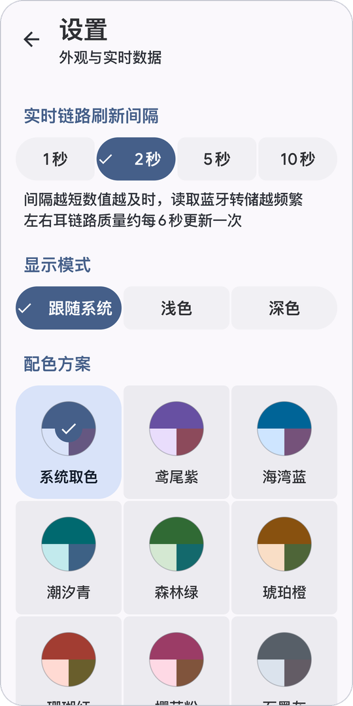

  

<h1 align="center">Encore</h1>

  让 OPPO Enco X4 在 ColorOS / OxygenOS 上常驻 LE Audio（LC3） 
  只接管 X4，系统游戏态和其他蓝牙耳机保持原样

  
  
  

  

## 特色

### 🎧 X4 专属 LE Audio 路由

ColorOS 平时让 Enco X4 走经典蓝牙（LHDC / AAC），只有白名单游戏运行时才切到 LE Audio。Encore 注入蓝牙进程，只为 X4 请求 LC3。

- 不开启系统全局游戏态，其他蓝牙耳机仍按系统默认方式连接
- 一键重连 X4，改完设置立即生效

### 📊 实时链路

<table>
  <tr>
    <td width="50%"></td>
    <td width="50%"></td>
  </tr>
  <tr>
    <td align="center">Media 场景 · 124 kbps · 最大传输时延 100 ms</td>
    <td align="center">Game 场景 · 80 kbps · 最大传输时延 20 ms</td>
  </tr>
</table>

- 编码、采样率、LC3 帧长、每声道码率、最大传输时延、重传次数和呈现延迟
- 左右耳 RSSI 与丢包率，来自蓝牙控制器的链路质量报告
- 刷新间隔可选 1、2、5、10 秒

### 🩺 前置条件诊断与日志

<table>
  <tr>
    <td width="50%"></td>
    <td width="50%"></td>
  </tr>
</table>

- 逐项检查双模共存、省电模式、双模白名单应用、X4 双连接偏好、通话与媒体音频和双耳 LE Audio 连接
- 条件不满足时主页会提示，诊断页提供对应的修复入口
- 一键导出诊断日志，蓝牙地址和设备专属偏好键会自动脱敏

### 🎨 Material 3 Expressive

- 跟随系统 Monet 取色，另有八套预设配色
- 浅色、深色或跟随系统
- 矢量耳机图标支持动态取色与单色主题图标

## 安装

1. 在本仓库的 Releases 下载 `encore.apk` 并安装。
2. 在支持 libxposed API 102 的 LSPosed 管理器中启用 Encore，勾选「蓝牙」（`com.android.bluetooth`）。
3. 在 Root 管理器中允许 Encore 使用超级用户。
4. 打开 Encore，点「重启作用域」。
5. 进入「连接设置 → 诊断与日志」，按提示补齐 LE Audio 前置条件。

覆盖安装新版本后，同样需要点一次「重启作用域」。

## 恢复系统行为

关闭「X4 路由接管」并重连 X4，或在 LSPosed 中停用 Encore 后重启蓝牙。开过「按播放内容切换」的话，请先把它关掉。

## 链接

[源码、适配范围与完整说明](https://github.com/JustDreemurr/enco-x4-lc3-manager) · [反馈问题](https://github.com/JustDreemurr/enco-x4-lc3-manager/issues)

> 本项目与 OPPO / OnePlus 无关，使用固件私有接口，风险自负。
